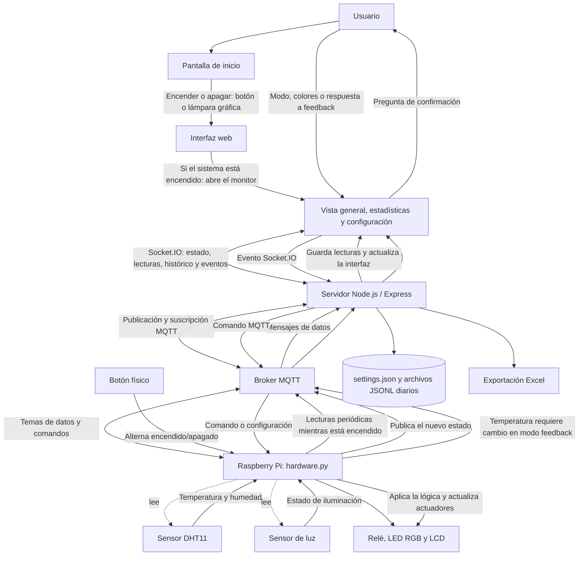

# Arquitectura y funcionamiento de la plataforma web euNICE

## 1. Propósito

euNICE es una plataforma para monitorizar las condiciones ambientales de una estancia y controlar un dispositivo conectado a una Raspberry Pi. Combina una interfaz web gráfica, un servidor intermedio y un dispositivo con sensores y actuadores.

La web no se comunica directamente con los pines de la Raspberry Pi: envía y recibe mensajes a través del servidor y de MQTT. Esta separación permite que el navegador presente los datos y gestione la interacción mientras el programa del dispositivo se ocupa de leer sensores y actuar sobre el hardware.

## 2. Arquitectura y tecnologías

| Componente | Tecnologías | Responsabilidad |
|---|---|---|
| Interfaz web | HTML, CSS y JavaScript | Pantalla de inicio, monitorización, configuración, estadísticas y controles |
| Actualización de interfaz | Socket.IO y Chart.js | Comunicación bidireccional en tiempo real y gráficas |
| Servidor web | Node.js y Express | Sirve la web, recibe mensajes MQTT, distribuye eventos, persiste información y prepara exportaciones |
| Mensajería | MQTT con MQTT.js en el servidor y Paho MQTT en la Raspberry Pi | Transporta lecturas, estados, órdenes y configuración |
| Dispositivo | Raspberry Pi y Python | Lee sensores y controla el relé, el LED RGB y la pantalla LCD |
| Persistencia e informes | JSON, JSONL y ExcelJS | Guarda ajustes e histórico y genera archivos Excel |

Express sirve los archivos estáticos de [`public/`](./public/). Socket.IO comunica el navegador con el servidor; MQTT comunica el servidor con el dispositivo. Chart.js dibuja las gráficas y ExcelJS construye la exportación Excel.

El servidor usa por defecto el broker MQTT `broker.emqx.io` en el puerto `1883`. El servidor acepta otro broker mediante la variable `MQTT_BROKER`; el programa Python también debe apuntar al mismo broker si se cambia. El puerto HTTP predeterminado es `3000` (`PORT`) y la ubicación de los datos puede cambiarse con `EUNICE_DATA_DIR`.

## 3. Experiencia de uso e interfaz

### Pantalla de inicio

La pantalla inicial es el punto de entrada y permite encender o apagar el sistema. Incluye un botón y una lámpara ilustrada interactiva —con una cuerda que funciona como interruptor— que representan el mismo control de encendido. Las animaciones y el indicador de estado cambian según el sistema está encendido o apagado.

La lámpara es un elemento visual de la interfaz, no un actuador de iluminación conectado a la Raspberry Pi. La lectura del sensor de luz se muestra como un estado aparte. Cuando el sistema está encendido, la interfaz habilita el acceso a **Abrir monitor**; el monitor también ofrece un control para apagar el sistema.

### Pantallas del monitor

- **Vista general:** estado del sistema, temperatura, humedad, iluminación y climatización.
- **Estadísticas:** gráfica y tabla diaria, navegación por los días disponibles y exportación a Excel. La gráfica ofrece líneas, barras y distribución circular de las lecturas por rango térmico.
- **Configuración:** modo automático o con confirmación, colores del LED para frío, confort y calor, y selección del tema visual.

### Diseño responsive

La web adapta la composición al ancho de pantalla usando una cuadrícula flexible, Flexbox, tamaños fluidos y puntos de ruptura CSS. En pantallas medianas reduce el ancho de navegación y dispone las tarjetas de sensores en dos columnas. En pantallas estrechas reorganiza la portada en una columna, transforma la navegación lateral en una barra fija inferior, apila los controles y las opciones de configuración, y ajusta la tabla y la gráfica para que puedan consultarse en móvil. También contempla anchos muy pequeños y respeta la preferencia del sistema para reducir el movimiento de las animaciones.

### Instalación como aplicación (PWA)

La web incluye un manifiesto, iconos y un *service worker*. Se puede abrir en una ventana propia, con apariencia de aplicación, sin distribuir una aplicación nativa por una tienda. El servidor exige el usuario `Euniceprueba` y una contraseña fija de al menos 12 caracteres, definida en el archivo local `.env`. Ese archivo no se sube a Git; `dotenv` lo carga al iniciar Node.

El Mac usa Tailscale Funnel con una URL estable que apunta al puerto `3000` del servidor Node. La configuración de Funnel se conserva en Tailscale; no hay código de túnel dentro del repositorio ni que generar una dirección nueva cada vez.

Para la demostración en clase:

1. En el Mac, comprueba que Tailscale esté conectado y, desde la carpeta del proyecto, ejecuta `node server.js` (o `npm start`). El servidor carga `.env`, escucha en el puerto `3000` y muestra en la terminal el enlace local y el de Tailscale Funnel. El enlace remoto requiere que Funnel esté activo.
2. En la Raspberry Pi, inicia el programa con `python3 hardware.py`. Mac y Raspberry deben tener acceso a Internet para comunicarse con el broker MQTT ya configurado en el proyecto.
3. En el móvil, abre `https://eunice.taild05234.ts.net/` e inicia sesión con el usuario `Euniceprueba` y la contraseña local.
4. Para instalar la PWA, en **iPhone** abre el enlace en Safari, pulsa **Compartir** y selecciona **Añadir a pantalla de inicio**; las notificaciones requieren iOS 16.4 o posterior y abrirla desde ese icono. En **Android**, abre el enlace en Chrome e instálala desde el menú.
5. En Configuración, activa las notificaciones y acepta el permiso del navegador.

Los avisos push cubren las solicitudes de confirmación del modo feedback y el encendido/apagado confirmado por la Raspberry. En el primer inicio, el servidor genera claves VAPID y las guarda en `data/vapid-keys.json`; las claves y las suscripciones de `data/push-subscriptions.json` están excluidas de Git. No borres las claves VAPID ni la carpeta de datos si quieres conservar las suscripciones existentes.

La PWA no mantiene el servidor encendido: al detener Node o apagar el Mac dejan de funcionar los datos en directo, los controles y los nuevos avisos. Funnel conserva la misma URL, pero solo puede alcanzar el servidor mientras el Mac y Tailscale estén activos. El broker MQTT público del proyecto se mantiene sin cambios, tal como está planteado para la demostración de clase.

## 4. Temas visuales y personalización del LED

La web incluye un tema claro y otro oscuro. El tema cambia los colores de fondo, superficies, texto y controles; también actualiza los colores de la gráfica y la barra de color del navegador. La preferencia se guarda en `localStorage` del navegador y se restaura al volver a abrir la web. Por eso es una preferencia del navegador utilizado, distinta de la configuración del dispositivo.

Además, se pueden personalizar los colores físicos del LED RGB para las categorías de frío, confort y calor. La web convierte los colores elegidos a valores RGB y los envía al servidor. El servidor los valida y los guarda en [`data/settings.json`](./data/settings.json), y envía la configuración a la Raspberry Pi. Los valores quedan asociados a las categorías térmicas; no modifican el tema visual de la página.

## 5. Integración y lógica del dispositivo

El programa [`hardware.py`](./hardware.py) se ejecuta en la Raspberry Pi. Usa un sensor DHT11 para temperatura y humedad, una entrada digital como sensor de luz, un relé para la climatización, un LED RGB, un botón físico y una pantalla LCD.

Mientras el sistema está encendido, lee los sensores y publica sus valores aproximadamente cada dos segundos. La pantalla LCD muestra temperatura y humedad. El LED indica el rango térmico y el relé se gobierna según el modo seleccionado. Al apagar el sistema desde la web o desde el botón físico, se detienen las lecturas periódicas y el ventilador se apaga; la pantalla muestra la fecha y la hora.

Los umbrales de temperatura implementados son:

- Menos de **25 °C**: calefacción.
- De **25 °C a 28 °C**, incluidos: climatización apagada.
- Más de **28 °C**: aire acondicionado.

Hay dos modos de funcionamiento:

- **Automático:** el propio dispositivo compara la temperatura con los umbrales y activa o desactiva el relé sin pedir una decisión para cada cambio.
- **Con confirmación (feedback):** el dispositivo informa de las lecturas y del estado; la web pregunta al usuario cuando detecta que la acción necesaria no coincide con la actual. Si el usuario acepta, la orden se envía al dispositivo. Si la rechaza, se mantiene el estado anterior cuando la petición sigue siendo válida.

Para soportar estos requisitos fue necesario ampliar el programa del dispositivo, no solo añadir controles visuales a la web. [`hardware.py`](./hardware.py) recibe y aplica la configuración de modo y colores, valida los valores RGB y los convierte al formato que usa la biblioteca del LED. También separa la actuación automática de la actuación bajo confirmación y comprueba que una orden de feedback siga correspondiendo a la necesidad térmica actual; así evita aplicar una respuesta que haya quedado desactualizada mientras llegaban nuevas lecturas.

El servidor guarda la configuración en disco y publica también un mensaje MQTT retenido con el modo y los colores. De este modo, el broker conserva el último mensaje de configuración y puede entregarlo cuando el dispositivo se suscribe o vuelve a conectarse.

### Temas MQTT principales

| Dirección | Tema | Contenido |
|---|---|---|
| Dispositivo → servidor | `euNICE/data/temperatura` | Temperatura |
| Dispositivo → servidor | `euNICE/data/humedad` | Humedad |
| Dispositivo → servidor | `euNICE/data/luz` | Estado o indicación de iluminación |
| Dispositivo → servidor | `euNICE/data/led` | Estado del sistema y categoría de color |
| Dispositivo → servidor | `euNICE/data/ventilador` | Estado de climatización |
| Servidor → dispositivo | `euNICE/comando/sistema` | Encendido/apagado, modo y acciones |
| Servidor → dispositivo | `euNICE/comando/configuracion` | Configuración persistente de modo y colores |

## 6. Registro histórico y persistencia

El servidor escribe un registro cuando el sistema está encendido y recibe un mensaje nuevo de temperatura. Cada línea contiene fecha, hora, marca de tiempo, temperatura, humedad, iluminación y estado de climatización. Para completar la entrada utiliza los últimos valores recibidos de humedad, iluminación y climatización.

Los registros se guardan en archivos JSON Lines diarios dentro de [`data/history/`](./data/history/), normalmente con un nombre como `AAAA-MM-DD.jsonl`. JSON Lines almacena un objeto JSON por línea. Al comenzar otro día se utiliza otro archivo; los archivos anteriores siguen disponibles para las estadísticas. Al iniciar, el servidor lee los archivos existentes y los ofrece al navegador. Si se apaga y se vuelve a encender el sistema, los registros ya guardados no se borran: las nuevas lecturas se añaden al histórico del día. Lo mismo ocurre al reiniciar el servidor, siempre que se conserve la carpeta de datos.

El modo de funcionamiento y los colores del LED se guardan por separado en [`data/settings.json`](./data/settings.json). El servidor carga esa configuración al arrancar y vuelve a publicarla al conectar con MQTT. Por tanto, las estadísticas y la configuración persisten en el servidor, no únicamente en la sesión del navegador. El tema claro/oscuro sí se conserva localmente en el navegador.

### ¿Por qué archivos JSON y no una base de datos?

Para el alcance actual —un dispositivo, un flujo de lecturas pequeño y un histórico que se consulta por día— JSONL ofrece una solución ligera: no requiere instalar ni mantener un motor de base de datos, permite añadir cada lectura al final del archivo, separa el histórico por fechas y facilita inspeccionar, copiar o respaldar los datos. El archivo JSON de configuración también es sencillo de leer y editar.

Es una elección adecuada para este volumen y despliegue, no una afirmación de que los archivos sean mejores que una base de datos en cualquier situación. Si el sistema creciera —por ejemplo, con muchos dispositivos, consultas complejas, escritura concurrente o requisitos transaccionales— sería razonable migrar a una base de datos. Como los datos residen en archivos del servidor, para conservarlos ante fallos de disco también es necesario respaldar la carpeta configurada en `EUNICE_DATA_DIR`.

Si faltan archivos históricos de alguno de los siete días anteriores, el servidor crea lecturas simuladas de demostración para esos días. Se identifican como ficticias en la interfaz y en la exportación para no confundirlas con datos recibidos del hardware. Las exportaciones Excel incluyen una hoja de gráfica/resumen y otra con las lecturas y su origen.

## 7. Diagrama del flujo entre usuario, web y dispositivo

## 8. Archivos principales

- [`server.js`](./server.js): servidor HTTP, eventos Socket.IO, integración MQTT, persistencia, histórico y exportación Excel.
- [`public/index.html`](./public/index.html): estructura de las pantallas, controles y contenido.
- [`public/styles.css`](./public/styles.css): estilos, animaciones, temas y reglas responsive.
- [`public/app.js`](./public/app.js): interacción de la interfaz, eventos, gráficas, comandos y exportación.
- [`public/manifest.webmanifest`](./public/manifest.webmanifest), [`public/service-worker.js`](./public/service-worker.js), [`public/brand-logo.png`](./public/brand-logo.png), [`public/icon-192.png`](./public/icon-192.png), [`public/icon-512.png`](./public/icon-512.png) y [`public/apple-touch-icon.png`](./public/apple-touch-icon.png): identidad visual, instalación de la PWA y recepción de avisos.
- [`feedback-notification.js`](./feedback-notification.js): regla compartida para detectar cuándo hace falta pedir confirmación.
- `.env`: configuración local ignorada por Git; guarda el usuario y la contraseña de acceso.
- [`hardware.py`](./hardware.py): lectura de sensores y control del hardware en la Raspberry Pi.
- [`data/settings.json`](./data/settings.json) y [`data/history/`](./data/history/): configuración e histórico persistidos.
